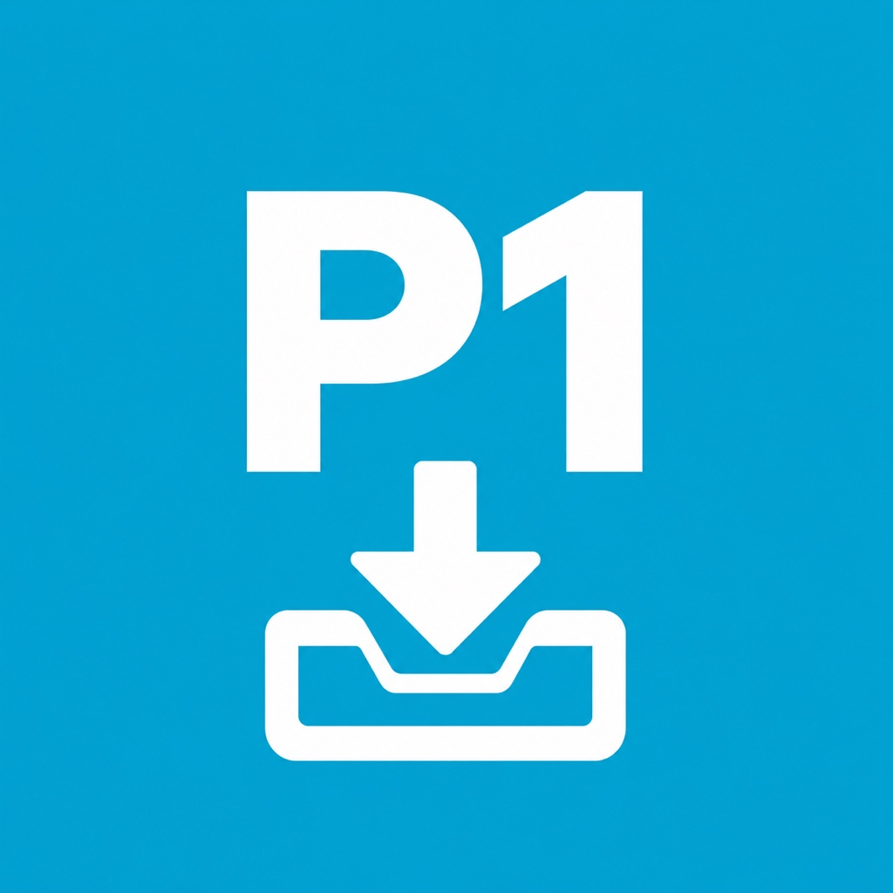

# P1 Transfer for Mac

**Get recordings off your BETAFPV P1 without Windows, Terminal commands, or a subscription.**

Created by **Kris Gleave — KrisTalksTech** for the FPV community.

P1 Transfer is a small, open-source macOS app that copies video recordings and accompanying `.srt` files from a P1 receiver over USB. The downloadable app includes its MTP tools: you do **not** need Homebrew, Xcode, or separately installed drivers to use it.

[Download the latest release](https://github.com/krisgleave/p1-transfer/releases/latest) · [Report a problem](https://github.com/krisgleave/p1-transfer/issues) · [Build from source](docs/BUILDING.md)

## Requirements

| | Current downloadable build (1.0) |
|---|---|
| Mac | Apple Silicon: M1 or newer |
| macOS | 27.0 or newer |
| Receiver | BETAFPV P1 with recordings accessible over USB MTP |
| Connection | Data-capable USB cable; power the receiver as required by its manual |
| Other software | None required for the packaged app |

The app was tested during development on an M4 Pro MacBook Pro with a P1 reporting **BETAFPV P1, Rev A**. Other P1 models and firmware versions need community testing. Intel Macs and earlier macOS versions are not supported by the current release.

## Download and use

1. Download the app ZIP from **Releases**, rather than GitHub's **Code → Download ZIP** source archive.
2. Unzip it and move **P1 Transfer** to Applications, if desired.
3. Quit other MTP apps, including OpenMTP, MacDroid and Android File Transfer.
4. Connect and power on the P1, then open P1 Transfer. It scans on launch and watches for a connection until one succeeds.
5. Tick the files you want, or use **Select All** and **Clear**.
6. Click **Download … files**, then choose the destination folder.

The app creates a folder such as `P1-recordings-20261104-134731`. The date and time are your Mac's local time. It displays total download percentage, average speed and an estimate of time remaining. Completed files are checked against the file size reported by the receiver. This is a size check, not a cryptographic integrity check.

**Copies only: originals remain on the receiver.** There is no delete or format button.

The current build is locally/ad-hoc signed, **not Apple Developer ID signed or notarised**. macOS may block or warn about it. See [installation notes](docs/INSTALLATION.md); you do not need to disable Gatekeeper to use the project.

## Features

- Native macOS interface with checkboxes and batch downloads.
- Downloads `.mp4` recordings and `.srt` sidecar files.
- Percentage, byte counts, average transfer speed and estimated time remaining.
- Automatic connection checks stop after a successful connection; **Refresh** is manual thereafter.
- Separate timestamped folder for each download batch.
- Keeps successful copies when a later transfer fails.
- Clears hidden-file flags so completed downloads appear in Finder.
- Bundled `libmtp` and `libusb`: no dependency installation for end users.

## Why this exists

The P1 appeared in Windows for file browsing, but did not appear as a normal Finder disk on the development Mac. USB inspection showed an MTP interface. Direct transfers through libmtp worked, while the GUI tools tried during development did not work reliably with that receiver.

P1 Transfer wraps those working MTP transfers in a simple native interface. It does **not** provide live FPV video, change receiver firmware, or make the P1 a standard USB mass-storage disk. It downloads through MTP directly and does not mount a Finder volume.

## Troubleshooting

| Symptom | What to try |
|---|---|
| No files listed | Power the P1, use a data cable, close other MTP apps, then click Refresh. |
| Receiver reconnected but list is stale | Click Refresh. Background checks stop after connection. |
| Transfer stopped | Successful files remain in the destination folder. Reconnect and refresh before retrying. |
| App says transfer failed | The app checks exit status and final size. A failed temporary file is removed; complete copies are retained. |
| Files seem missing | Check the exact timestamped destination folder. Current versions clear the hidden flag on completed files. |
| About 12 MB/s | This was observed during development, not imposed by the app. Speed depends on the receiver, storage, USB connection and MTP implementation. |
| Hawkeye Ai15 in diagnostic output | The tested device uses USB ID `1d6b:0101`, which libmtp labels Hawkeye Ai15. The device itself reports BETAFPV P1. |

Transfers are sequential. The current implementation has a 10-minute timeout per file, so very large files may time out. The speed is an average across the batch, including setup time. Time remaining is an estimate.

See [architecture and limitations](docs/ARCHITECTURE.md) and [contributing](CONTRIBUTING.md).

## Support the project

P1 Transfer is free and open source. Community testing, useful bug reports, documentation and code contributions are welcome. Optional donation links will be added here once the maintainer has configured them; donations are not required to use the app.

## Credits and licence

- **Project creator and maintainer:** Kris Gleave (**KrisTalksTech**).
- **Implementation:** developed with assistance from OpenAI Codex; icon artwork created with an AI image-generation tool.
- **MTP transfers:** [libmtp](https://github.com/libmtp/libmtp) contributors.
- **USB access:** [libusb](https://github.com/libusb/libusb) contributors.

The app source and original project assets are released under the [MIT licence](LICENSE). Bundled third-party software retains its own LGPL-2.1-or-later licences; see [THIRD_PARTY_NOTICES.md](THIRD_PARTY_NOTICES.md). Exact upstream source archives are included in this repository and in the downloadable app.

This is an **independent community utility**, not an official BETAFPV or Apple product. BETAFPV, P1 and Apple names identify compatibility and belong to their respective owners. The original P1 Transfer icon uses a blue inspired by BETAFPV's branding; it does not use the BETAFPV logo.
