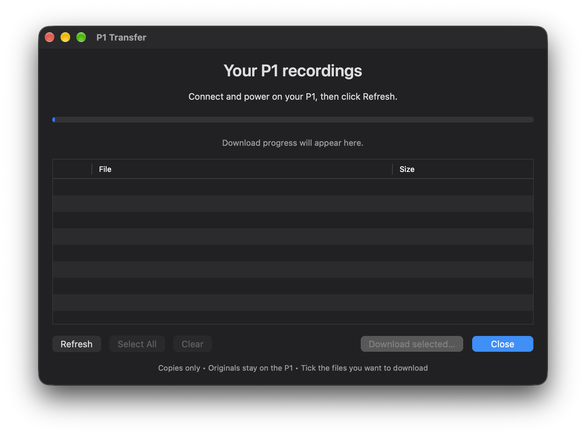

# P1 Transfer v1.1

P1 Transfer is a free macOS utility for copying BETAFPV P1 recordings and SRT files without Windows or separate MTP software.

## Updated interface

- Simplified window title: **P1 Transfer**
- Blue **Close** button positioned at the bottom-right
- Consistent spacing around the interface
- Blue download button when recordings are selected
- Standard application name: **P1 Transfer.app**

## Installation

Download the `.pkg` installer from [GitHub Releases](https://github.com/krisgleave/p1-transfer/releases/tag/v1.1) and follow the macOS installer.

A standalone ZIP is also available.

Requires Apple Silicon and macOS 27.0 or later. The app bundles libmtp and libusb, so no additional drivers or Homebrew installation are needed.

The app is ad-hoc signed and not Apple notarised. See [installation instructions](docs/INSTALLATION.md) for macOS security guidance.

## Features

- Native macOS interface
- Select individual recordings or all files
- Download MP4 recordings and SRT sidecar files
- Progress reporting and estimated remaining time
- Timestamped download folders
- Copy-only transfers; originals remain on the P1

## Screenshot

## Previous release

Version 1.0 introduced standalone P1 recording downloads, bundled dependencies and the original macOS interface.
